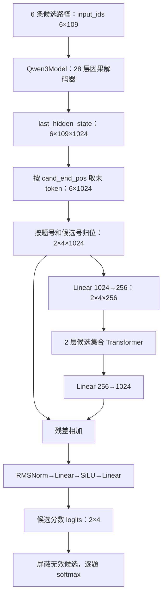

# 02：实际 Qwen3 如何变成候选决策模型

本文对应 [agentjev/model.py](../agentjev/model.py)，沿用上一篇的两道真实题。
配置来自本地模型文件，参数量和示例预测经过 CPU 核对。
前向示例使用训练集，职责是解释计算过程，不能作为泛化性能测试。

## 1. 先确认本地模型身份

对应代码：[下载脚本的 REPO_ID](../scripts/download_backbone.py#L13)、
[实际加载 Qwen3Model 的构造函数](../agentjev/model.py#L139)。

本地路径为 `models/Qwen3-0.6B-Base/`，但当前
[download_backbone.py](../scripts/download_backbone.py) 中：

```python
REPO_ID = "Qwen/Qwen3-0.6B"
revision = "main"
```

本地模型卡标题也为 `Qwen3-0.6B`。因此，“Base”在这里首先是目录命名，
不能把它当作“已下载 Qwen/Qwen3-0.6B-Base”的证据。
这里是从预训练/已有 Qwen 权重初始化骨干，再训练新决策头，
不是将整个 Qwen3 随机初始化；`experiment` 名中的 `from_scratch` 也不改变这段实际逻辑。

本地 `config.json` 的关键内容：

| 字段 | 本地值 | 本项目如何使用 |
|---|---:|---|
| architectures | Qwen3ForCausalLM | 描述下载权重原先的语言模型结构 |
| hidden_size | 1024 | 候选向量的维度 |
| num_hidden_layers | 28 | Qwen3 解码器层数 |
| intermediate_size | 3072 | Qwen3 前馈层中间维度 |
| num_attention_heads | 16 | Q 注意力头数 |
| num_key_value_heads | 8 | KV 头数，使用分组查询注意力 |
| head_dim | 128 | 注意力头维度，应读取此字段，不直接用 1024/16 推算 |
| vocab_size | 151936 | 输入 embedding 的词表大小 |
| max_position_embeddings | 40960 | 本地骨干配置的上限；本项目路径限制更小，为 2048 |
| torch_dtype | bfloat16 | 下载权重的精度信息 |
| tie_word_embeddings | true | 原语言模型的词嵌入/输出头共享配置 |

模型卡的上下文说明与本地配置字段应分别理解；本项目实际以 `max_tokens=2048`
拒绝过长路径，不使用这里的全部上下文容量。

用于定位本次核对文件的 SHA256：

```text
config.json:
660db3b73d788119c04535e48cf9be5f55bc3100841a718637ae695b442f27dd
tokenizer.json:
aeb13307a71acd8fe81861d94ad54ab689df773318809eed3cbe794b4492dae4
```

下载脚本没有固定模型 commit；将来重跑 `main` 时需要重新核对这些文件，
不能由相同目录名推断权重未变。

## 2. AgentJevModel 的组装

对应代码：[AgentJevModel.__init__](../agentjev/model.py#L139)。

构造函数首先执行：

```python
backbone = Qwen3Model.from_pretrained(backbone_path, torch_dtype=dtype)
hidden = backbone.config.hidden_size  # 本地实际为1024
```

加载的是 `Qwen3Model`，不包含预测下一个词的语言模型输出头。
因此出现 `lm_head.weight UNEXPECTED` 与当前用途相符：这部分下载权重没有被使用。
`generation_config.json` 的采样温度、top_p、top_k 也不参与候选评分。

后面新建：

```python
self.proj_in = nn.Linear(1024, 256)
self.set_encoder = CandidateSetEncoder(256, 4, 2)
self.proj_out = nn.Linear(256, 1024)
self.scorer = ScalarScorer(1024, 256)
```

上面是代入本地维度后的展开示例；源码实际保留配置变量，摘录如下：

```python
self.proj_in = nn.Linear(hidden, set_dim)
self.set_encoder = CandidateSetEncoder(set_dim, set_heads, set_layers)
self.proj_out = nn.Linear(set_dim, hidden)
self.scorer = ScalarScorer(hidden, set_dim)
```

其中 hidden 来自本地 config，set_dim、set_heads、set_layers 默认分别为 256、4、2。

实际参数量如下，按实例中的参数统计：

| 部分 | 参数量 |
|---|---:|
| Qwen3Model 骨干 | 596,049,920 |
| 新候选头合计 | 2,368,769 |
| AgentJevModel 总计 | 598,418,689 |

本地 safetensors 里还保存了 `lm_head.weight`，所以直接把文件全部张量元素相加，
会得到 751,632,384，不能当成当前 AgentJev 的参数量。

构造函数默认 `dtype=torch.float32`，训练入口没有覆盖它。
因此加载到模型中的权重为 FP32；训练时用 BF16 autocast 做混合精度运算。
“模型原文件为 BF16”“参数保留 FP32”“运算启用 BF16 autocast”是三个不同层面。

## 3. 两道实际题的完整形状流

上一篇已经得到 6 条路径，输入形状 `[6,109]`，两道题最多 4 个候选。



### 3.1 PathEncoder：读取每条路径的最后一个真实 token

对应代码：[PathEncoder.forward](../agentjev/model.py#L101)。下面摘录主干运算，P 表示路径数。

```python
out = self.backbone(
    input_ids=batch["input_ids"],
    attention_mask=batch["attention_mask"],
    use_cache=False,
)
hs = out.last_hidden_state
h = hs[torch.arange(P, device=hs.device), batch["cand_end_pos"]]
```

本例取的是各行位置 `[104,106,108,103,99,98]`，不是统一取第 108 个位置。
这样不会把右侧 padding 的隐藏状态当作候选表示。
骨干是因果模型，末 token 可以结合此前的 state、问题及当前候选描述。
这里没有均值池化或额外的 CLS token。

随后：

```python
cand_vecs = hs.new_zeros(Bq, Cmax, hs.size(-1))
cand_vecs[batch["q_index"], batch["cand_index"]] = h
```

把 `[6,1024]` 放回 `[2,4,1024]`。第二题最后两个候选槽位是补齐项。
骨干中不同路径没有互相注意；state 和 question 会在各候选路径中重复计算。

### 3.2 CandidateSetEncoder：让同一题的候选相互比较

对应代码：[CandidateSetEncoder.__init__](../agentjev/model.py#L56)、
[CandidateSetEncoder.forward](../agentjev/model.py#L70)。

`proj_in` 先把每个候选压到 256 维，再通过两层 TransformerEncoder。
每层使用 4 个注意力头、1024 维前馈层、GELU、`norm_first=True`、`dropout=0`。
这里序列轴表示候选项，不是原文本 token；候选之间可以双向注意。
不同题是 batch 中不同元素，不会在该注意力层里互相混合。

候选头不加位置嵌入，所以交换候选及其掩码时，输出应随之交换，而不是依赖槽位编号。
这叫候选排列等变；并不表示把候选顺序打乱后输出数组还能保持原顺序。
实际 BF16 计算可能有微小数值误差。

本项目 `cand_mask=True` 表示有效，而 PyTorch 的 `src_key_padding_mask=True`
表示忽略，因此传入的是 `~cand_mask`。候选头并不使用文本的 attention_mask。
`enable_nested_tensor` 的提示是该优化路径因 norm_first 未启用，不改变此处模型定义。

### 3.3 残差和 ScalarScorer

对应代码：[AgentJevModel._score](../agentjev/model.py#L177)、
[ScalarScorer](../agentjev/model.py#L76)、[RMSNorm.forward](../agentjev/model.py#L42)。

下面摘录完整的候选评分路径，可与前面的维度图逐行对应：

```python
def _score(self, cand_vecs: torch.Tensor, cand_mask: torch.Tensor) -> torch.Tensor:
    x = self.proj_in(cand_vecs)
    x = x * cand_mask.unsqueeze(-1).to(x.dtype)
    enc = self.set_encoder(x, cand_mask)
    rep = cand_vecs + self.proj_out(enc)
    logits = self.scorer(rep)  # [Bq, Cmax]
    return logits.masked_fill(~cand_mask, -1e4)
```

例如 `cand_mask.unsqueeze(-1)` 从 `[2,4]` 变为 `[2,4,1]`，广播到 256 维候选表示，
先把无效槽位置零；最后再屏蔽无效槽位的标量分数。

其中的残差步骤是：

```python
rep = cand_vecs + self.proj_out(enc)
logits = self.scorer(rep)
```

残差把原始 Qwen3 候选向量与比较后的修正向量相加。
ScalarScorer 的处理为：

```text
1024维候选表示 → RMSNorm → Linear(1024,256) → SiLU → Linear(256,1)
```

本文件的 RMSNorm 先转 FP32，按最后一维的均方值归一化，乘可学习权重，
最后转回输入精度。最终每个候选只有一个标量分数。
同一个 scorer 为所有题型、所有候选复用，不是固定输出四个业务类别的分类器。

`_score()` 把无效槽位设为 `-1e4`，训练损失和服务推理还会将其进一步屏蔽为 `-inf`。
softmax、温度和答案格式化由调用方完成，`forward()` 返回的是 logits 和 mask。

## 4. 用已训练 checkpoint 看实际输出

用 `runs/agentjev_v1/best.pt`，step=600、seed=20260921，
在 CPU、FP32、eval/inference 模式下，对上述两题一起前向，得到：

| action 候选 | 教师 target | 模型 logit | 模型概率，未校准 |
|---|---:|---:|---:|
| continue | 0.073333 | -1.365081 | 0.089912 |
| human_review | 0.570000 | 0.471882 | 0.564414 |
| observe | 0.296667 | -0.226715 | 0.280673 |
| stop | 0.060000 | -1.689504 | 0.065001 |

logit 可以为负，也不要求总和为 1；经过逐题 softmax 后才成为概率。
本题选择 human_review，且其完整预测分布接近教师标签。

| needs_review 候选 | 教师 target | 模型 logit | 模型概率，未校准 |
|---|---:|---:|---:|
| true | 0.666667 | -0.011271 | 0.662385 |
| false | 0.333333 | -0.685214 | 0.337615 |

对应的候选表示实际形状为 `[2,4,1024]`，logits 为 `[2,4]`，
第二题后两项被屏蔽，不参与 softmax。CPU FP32 数值不保证逐位等于训练报告中的
GPU BF16 数值；本例用于核对数据到模型输出的对应关系。

### 在本地重现这个 CPU 前向

以下完整代码在 `text_jev_train/` 目录、已激活环境时执行。
它需要本地模型、prepared 数据以及该 checkpoint，消耗数 GB 主机内存，
不执行反向传播或优化器更新。这里手动构造与 batch() 相同布局的 CPU 张量，
因为当前 train.py 的 batch() 把设备固定在 CUDA。

```python
import json
from pathlib import Path
import torch
from transformers import AutoTokenizer
from agentjev.model import AgentJevModel
from jev_service.contract import encode_paths

torch.set_num_threads(4)
model_path = "models/Qwen3-0.6B-Base"
tok = AutoTokenizer.from_pretrained(model_path, local_files_only=True)
model = AgentJevModel(model_path).eval()
bundle = torch.load(
    "runs/agentjev_v1/best.pt", map_location="cpu", mmap=True, weights_only=True
)
model.load_state_dict(bundle["state_dict"])
print("step:", bundle["step"], "seed:", bundle["protocol"]["seed"])
del bundle

lines = Path("prepared/train_questions.jsonl").read_text().splitlines()
rows = [json.loads(line) for line in lines[:2]]
paths, qi, ci = [], [], []
for i, row in enumerate(rows):
    sequences = encode_paths(
        [{"state": row["state"], "questions": [row["question"]]}], tok
    )[0]
    for j, seq in enumerate(sequences):
        paths.append(seq)
        qi.append(i)
        ci.append(j)

length = max(map(len, paths))
cmax = max(len(row["target"]) for row in rows)
ids = torch.full((len(paths), length), tok.pad_token_id, dtype=torch.long)
attention = torch.zeros_like(ids)
mask = torch.zeros(len(rows), cmax, dtype=torch.bool)
for p, seq in enumerate(paths):
    ids[p, :len(seq)] = torch.tensor(seq)
    attention[p, :len(seq)] = 1
for i, row in enumerate(rows):
    mask[i, :len(row["target"])] = True
b = {
    "input_ids": ids,
    "attention_mask": attention,
    "cand_mask": mask,
    "q_index": torch.tensor(qi),
    "cand_index": torch.tensor(ci),
    "cand_end_pos": torch.tensor([len(seq) - 1 for seq in paths]),
}
with torch.inference_mode():
    logits = model(b)["logits"].float().masked_fill(~mask, float("-inf"))
    probs = torch.softmax(logits, dim=-1)
for row, distribution in zip(rows, probs.tolist()):
    print(row["id"], distribution[:len(row["target"])])
```

这个 b 没有 target 字段也能完成 forward，正好说明模型前向不读取教师标签。

## 5. 文件里存在、但当前训练没有启用的分支

对应代码：[TreeEncoder.forward](../agentjev/model.py#L131)、
[AgentJevModel.forward 的 perm_reg 分支](../agentjev/model.py#L185)、
[参数分组辅助方法](../agentjev/model.py#L166)。

- `TreeEncoder.forward()` 直接抛出 NotImplementedError。训练默认是 `encoder_impl="path"`，
  不能把它描述为已经启用树注意力训练。
- `forward(perm_reg=True)` 会复用已编码向量，将候选随机重排、评分，再还原顺序，
  返回 `logits_perm`。函数没有自行计算 KL 损失；当前 train.py 既未传入 True，
  也没有加入排列正则项。
- `backbone_named_parameters()`、`head_named_parameters()` 是参数分组辅助接口。
  当前训练入口用名称里是否包含 `.backbone.` 来分组，没有调用这两个辅助方法，
  也没有实施逐层学习率衰减。
- 推理服务的共享前缀位于 `jev_service/prefix.py`，不是这里未实现的 TreeEncoder。
