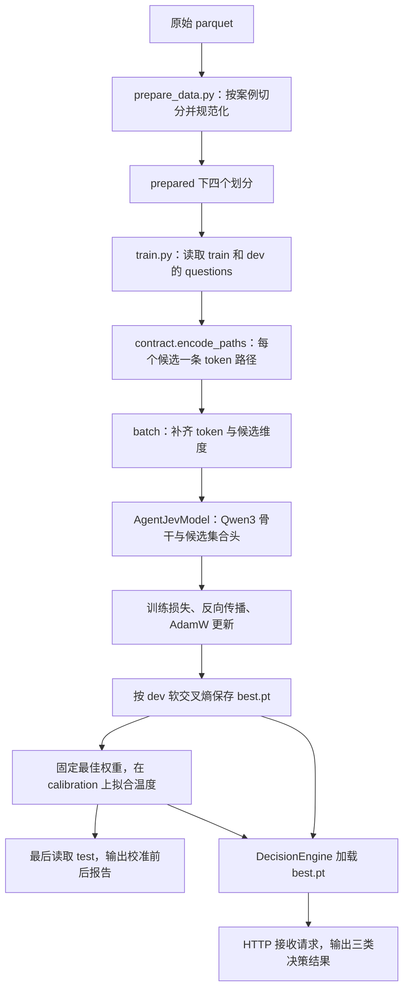

# 文本决策模型源码导读

本组文档以当前 [train.py](../scripts/train.py) 为主线，解释本目录的数据处理、
Qwen3 决策模型、训练评估和服务实现。示例核对日期为 2026-10-25。
读取了本地模型配置、tokenizer、`prepared/` 和已完成的 `runs/agentjev_v1/`，
并用该运行的 checkpoint 做了 CPU 前向核对；没有重新训练。

## 阅读顺序

| 文档 | 主要回答的问题 |
|---|---|
| [01-实际数据到模型输入.md](01-实际数据到模型输入.md) | 四个划分如何产生？requests 和 questions 如何转换？paths、padding、索引是什么？ |
| [02-实际模型架构与前向计算.md](02-实际模型架构与前向计算.md) | 本地 Qwen3 究竟是哪一个模型？1024 维向量如何变成候选概率？ |
| [03-训练选优校准与测评.md](03-训练选优校准与测评.md) | train.py 每一步做什么？损失、梯度累积、温度与报告如何计算？ |
| [04-输入协议与推理服务.md](04-输入协议与推理服务.md) | jev_service 各文件如何协作？三类答案如何返回？共享前缀何时启用？ |
| [执行日志/源码示例核对.log](执行日志/源码示例核对.log) | 实际模型维度、样本长度、参数量和 CPU 前向数值的核对摘要 |

## 从训练入口看整个过程

训练和服务都让模型为候选描述评分。模型不通过 `generate()` 输出答案文本，
也没有分别为 boolean、choice、score 建三个分类头；三种类型共用同一个候选评分器。

## 本组文档的实际对象

- 本地底座：`models/Qwen3-0.6B-Base/`。这是目录名；当前下载脚本的来源是
  `Qwen/Qwen3-0.6B`，不能仅凭目录名认定它是上游 `Qwen3-0.6B-Base`。
- 数据：`prepared/`，来源 revision 固定为
  `ea9306458d6e9563628369a3d1e72e362fb381d2`。
- 贯穿示例：训练案例 `tr_agent_trace_observability_000212`，重点看 `action`
  和 `needs_review` 两题。样本标识只用来定位和回传，不编码进模型输入。
- 已完成运行：`runs/agentjev_v1/`，最佳步数 600，checkpoint 中的训练种子为
  `20260921`。当前 `scripts/protocol.json` 的种子为 `42`，二者不能混写。
- 训练标签：公开教师概率分布。报告中的 accuracy 是与教师 argmax 的一致率，
  不是实际 Agent 任务成功率；训练集样本的前向示例也不能作为泛化能力证据。

数据和权重不随文档复制，需按 [实验 README](../README.md) 下载并准备。
文中除标注“示意”的部分外，样本数、token 长度和实测值都来自上述文件。
源码中的行为可能随之后的修改变化，阅读时优先核对链接到的实现。

## 怎样对照代码阅读

正文中的“对应代码”链接使用相对路径加 `#L行号` 定位当前源码，代码块标明是源码摘录
还是结合本地配置的展开示例。源码摘录通常依赖所在函数的上下文，不等于独立可运行脚本；
第二篇的完整 CPU 示例则可以单独执行。之后源码插入新行可能使行号偏移，可按链接标签中的函数名搜索。

| 主线步骤 | 可直接定位的实现 |
|---|---|
| 案例转单题、整理标签 | [prepare_data.convert](../scripts/prepare_data.py#L26) |
| 读取 questions 文件 | [train.load](../scripts/train.py#L56) |
| 单题变候选路径 | [train.tokenize](../scripts/train.py#L65)、[contract.encode_paths](../jev_service/contract.py#L68) |
| 张量打包与归属索引 | [train.batch](../scripts/train.py#L75) |
| 骨干读取末 token | [PathEncoder.forward](../agentjev/model.py#L101) |
| 候选集合比较与评分 | [AgentJevModel._score](../agentjev/model.py#L177) |
| 梯度计算与更新 | [train.main 的训练循环](../scripts/train.py#L294) |
| 评估与指标计算 | [train.evaluate](../scripts/train.py#L162)、[train.metrics](../scripts/train.py#L113) |
| checkpoint 选优 | [dev 比较与保存](../scripts/train.py#L326) |
| 拟合温度 | [train.calibrate](../scripts/train.py#L179) |
| 最终测试 | [test 加载与报告](../scripts/train.py#L360) |
| 推理服务调用链 | [DecisionEngine.evaluate](../jev_service/engine.py#L48) |

## 源文件与阅读位置

| 文件 | 职责 |
|---|---|
| [scripts/download_data.py](../scripts/download_data.py) | 固定数据 revision，校验下载字节数和 SHA256 |
| [scripts/download_backbone.py](../scripts/download_backbone.py) | 下载模型快照；当前使用 `revision="main"` |
| [scripts/prepare_data.py](../scripts/prepare_data.py) | 案例切分、协议转换和软标签排列 |
| [scripts/train.py](../scripts/train.py) | 加载数据、训练、选优、校准、测试和保存产物 |
| [agentjev/model.py](../agentjev/model.py) | Qwen3 路径编码器与候选集合评分头 |
| [jev_service/contract.py](../jev_service/contract.py) | 输入规范化、token 路径构造、答案格式化 |
| [jev_service/prefix.py](../jev_service/prefix.py) | 推理时按路径编码或共享前缀 KV |
| [jev_service/engine.py](../jev_service/engine.py) | 加载 checkpoint，运行推理并应用温度 |
| [jev_service/server.py](../jev_service/server.py) | HTTP 路由、请求大小限制和异常响应 |
| [scripts/serve.py](../scripts/serve.py) | 面向本目录训练产物的服务启动入口 |

`agentjev/__init__.py` 仅声明包说明和版本，`jev_service/__init__.py` 仅声明包说明，
二者不包含额外训练或推理逻辑。
